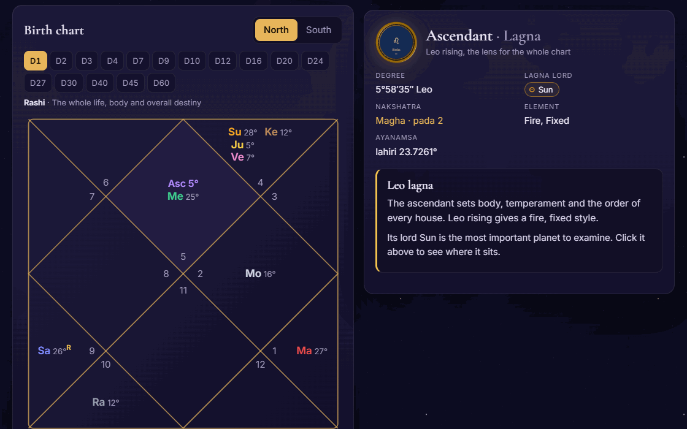
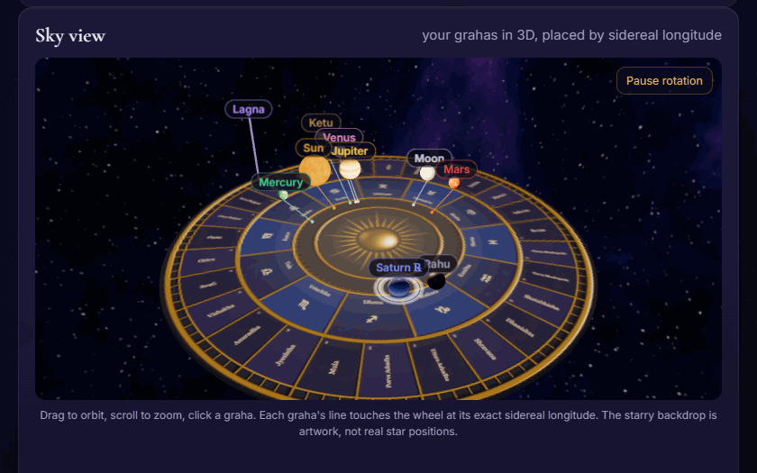
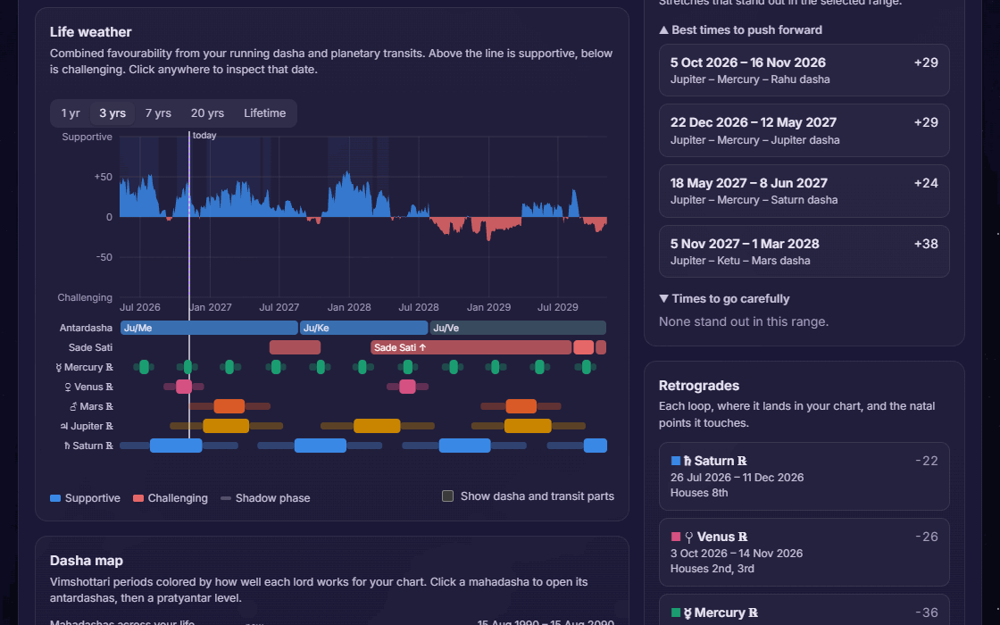

<p align="center"><a href="https://destinjones.github.io/vedic-astrology/"></a></p>

# Jyotisha Explorer

**Your entire Vedic chart. Nothing held back.** Every divisional chart, 44 yogas, 9 doshas, a 3D birth sky and a lifetime timeline of your good years, your hard years and every retrograde between them. Free, open source, in your browser, with no account.

**▶ [Open the site](https://destinjones.github.io/vedic-astrology/) · [Reveal my chart](https://destinjones.github.io/vedic-astrology/app/) · [See a sample chart](https://destinjones.github.io/vedic-astrology/app/#sample)**

[](https://github.com/destinjones/vedic-astrology/actions/workflows/ci.yml)
[](LICENSE)


There is no second page and no price. Click any planet, house or nakshatra and the reading is simply there.

## What you get

| | |
|---|---|
| **16 divisional charts** | D1 to D60, North or South Indian style, every one clickable |
| **603 written placement readings** | Planet in sign (108), in house (108), in nakshatra (243), house lords (144), plus dignities, retrogrades, 35 conjunctions and aspects |
| **44 yogas, 9 doshas** | Each one found with the exact reason it forms and any cancellations |
| **Shadbala and Bhava Bala** | All six planetary strengths and the twelve house strengths, in rupas against the classical minimums, checked against B. V. Raman's worked example |
| **27 nakshatras, 108 padas** | Deity, symbol, shakti, gifts and shadows, on a wheel you can click |
| **Bhava chalit** | Sripati or equal-house bhava chart beside the rashi chart; readings follow whichever you show |
| **Panchanga** | Tithi, vara, nakshatra, yoga and karana for your birth and any date, with end times |
| **Planet condition** | Baladi, Jagradadi and Deeptadi avasthas, gandanta, planetary war, mrityu bhaga and pushkara degrees |
| **Dashas to three levels** | Maha, antar and pratyantar, each scored with reasons, with sandhi and chidra junctions flagged |
| **Life weather** | Dashas plus transits over your Moon as one line, from one year to a lifetime, with good and hard stretches found for you |
| **Retrogrades and Saturn** | Mercury to Saturn stations and shadows, Sade Sati with re-entries, Kantaka and Ashtama Shani |
| **Ashtakavarga** | All seven tables, the SAV and who gave each point |
| **Varshaphal** | The Tajika annual chart for any year, cast for the second the Sun returns: Muntha, year lord, Tajika yogas, 20 Sahams and the Mudda dasha |
| **Four ayanamsas** | Lahiri, True Chitra, Raman and Krishnamurti |

## Hold your birth sky in your hands

<a href="https://destinjones.github.io/vedic-astrology/app/#sample"></a>

Nine planets rendered in Blender, each tethered to its exact sidereal degree. Spin it, zoom it, click a planet to read it. Planet longitudes are calculated from your birth data. The starry backdrop is artwork, not a map of real stars.

## See your whole life as weather

<a href="https://destinjones.github.io/vedic-astrology/app/#sample"></a>

## Why you can check all of it

- **Real ephemeris.** Positions come from the [Swiss Ephemeris](https://www.astro.com/swisseph/), compiled to WebAssembly.
- **Tested against real events.** The suite checks the Mercury stations of April 2024, Saturn entering sidereal Pisces on 2025-03-29, Jupiter entering Gemini on 2025-05-14, published Sade Sati dates and ashtakavarga totals (SAV = 337). `npm test` runs all 75 tests.
- **Your birth data stays home.** The chart is worked out and saved in your browser. The only thing sent anywhere is the text you type in the place box, to a city lookup, and you can skip that by entering coordinates by hand. Fonts and art are served from this site. There is no analytics unless the site owner turns on the optional cookieless visit counter, which sends page paths and event names only, never birth details (see `apps/web/README.md`).
- **Every rule is public.** Read how a yoga is detected in [`packages/interpretations`](packages/interpretations/src/yogas.ts). Disagree with one? Open an issue.

## Keep your feet on the ground

Astrology is a traditional practice, not a science, and no chart can promise what will happen to you. Readings and scores show what the tradition says, for reflection. They are not medical, legal or financial advice, so please don't make big decisions on them alone.

## Run it yourself

```bash
git clone https://github.com/destinjones/vedic-astrology.git
cd vedic-astrology
npm install
npm run dev -w @vedic/web
```

Then open <http://localhost:5173/>. The chart itself is at `/app/`.

| Path | What it is |
|---|---|
| [`apps/web`](apps/web) | The landing page and the explorer (Vite, React, three.js) |
| [`packages/engine`](packages/engine) | Sidereal chart engine on the Swiss Ephemeris |
| [`packages/timing`](packages/timing) | Dasha scoring, transits, Sade Sati, retrogrades, ashtakavarga, timeline UI |
| [`packages/interpretations`](packages/interpretations) | The readings and the yoga and dosha detectors |
| [`packages/tajika`](packages/tajika) | Varshaphal: the Tajika annual chart and its readings |
| [`blender`](blender), [`assets/3d`](assets/3d) | The scripts that render the art, and the renders |
| [`tools`](tools) | The site check that guards each deploy, and the recorder for these GIFs |

`npm run build:pages && npm run smoke` builds the site as GitHub Pages serves it and checks it in a real browser. `npm run demos` records the GIFs again from that build.

## License

[AGPL-3.0-or-later](LICENSE), because the Swiss Ephemeris is AGPL or paid. If you run a changed copy as a website, you must offer your visitors its source. See [NOTICE](NOTICE) for everyone this is built on, including place search by [Open-Meteo](https://open-meteo.com/) and [GeoNames](https://www.geonames.org/) (CC BY 4.0).
